# 特特管家 (Teskeeper) — screen and feature reference

Third-party Tesla companion app captured as a design and feature reference for Odo.
中文版：[`REFERENCE-TETE.zh-CN.md`](REFERENCE-TETE.zh-CN.md). Screenshots: [`mockups/tete/`](mockups/tete/).
Gap analysis and recommendations for Odo: [`GAP-ANALYSIS.md`](GAP-ANALYSIS.md).

---

## 1. Capture metadata

| Item | Value |
| --- | --- |
| Device | iPhone 14 Pro Max (iPhone15,3), iOS 27.2 |
| App | Teskeeper 3.0.2, bundle `com.axbear.love.TeslaCamera` (App Store: 特特管家-特斯拉车主必备) |
| Date | 2026-11-04 |
| Vehicle shown | Model 3 LR AWD ("Model3+ Agent"), software 2026.26.200.11, VIN LRW3E7EK2RC360512 |
| Method | `xcrun devicectl device capture screenshot`; navigation driven by a temporary XCUITest target (removed afterwards) |
| Redaction | The access token on the settings screenshot is blurred; the server URL is the owner's own host |

Screenshots are 700 px-wide JPEGs of 1290×2796 originals. Every screen was reached by tapping
real UI, so what is shown is the app as an ordinary user sees it.

## 2. Screen map

Home is a single long scroll with ten feature tiles; everything else hangs off it or off the
top bar. There is no tab bar.

| # | Screen | Entry point |
| --- | --- | --- |
| 1 | 首页 (vehicle overview) | app launch |
| 2 | 悬浮数据 (driving HUD settings) | home → 今日看板 `pip` button |
| 3 | 选择日期 (state timeline date picker) | home → 今日看板 calendar button |
| 4 | 车辆状态说明 (state legend) | home → 今日看板 `?` button |
| 5 | 3D 车模全屏 (full-screen car viewer) | home → vehicle card expand button |
| 6 | 绑定电脑小组件 (desktop widget pairing) | top bar → QR button |
| 7 | 行程记录 + 行程详情 | home tile |
| 8 | 充电记录 + 充电详情 | home tile |
| 9 | 停车记录 + 停车详情 | home tile |
| 10 | 电池健康分析 + 电池设置 | home tile |
| 11 | 行程日历 | home tile |
| 12 | 地图轨迹 + 筛选条件 | home tile |
| 13 | 充电地图 / 共享充电地图 | home tile |
| 14 | 能耗分析 | home tile |
| 15 | 动能回收 | home tile |
| 16 | 车辆自动化 → 官方授权 | home tile |
| 17 | 设置 (appearance, data source, server) | top bar gear |
| 18 | 卡片管理 / 蓝牙仪表 / 免责声明 | settings |
| 19 | 通知 | top bar bell |
| 20 | 寻找车辆 | top bar arrow |
| 21 | 行车记录仪查看 | top bar dashcam icon |

## 3. 首页 — vehicle overview

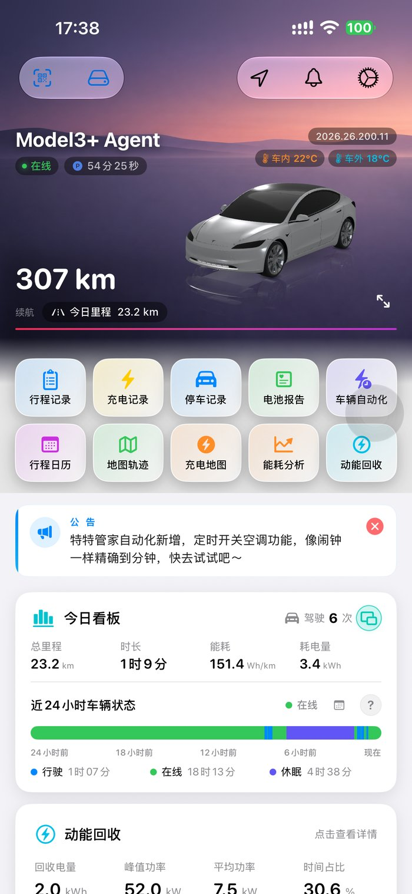

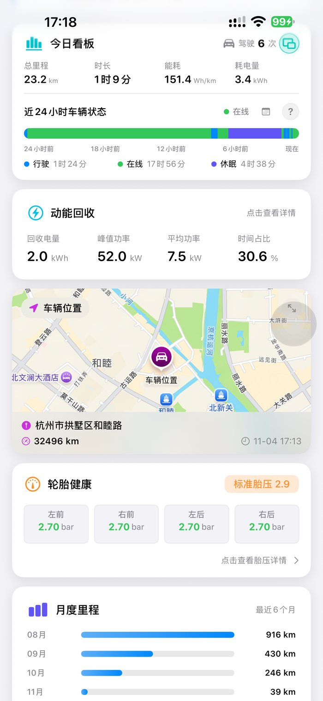

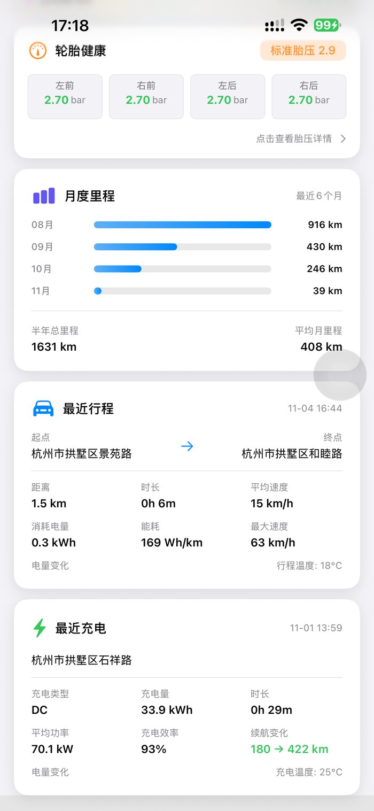

- **Top bar**, icon-only inside pill containers: 绑定电脑小组件 (QR), 行车记录仪查看, 寻找车辆, 通知, 设置.
- **Hero card**: 3D car model, vehicle name, online pill, parked duration, software version,
  cabin and outside temperature, range in large type, today's distance, battery bar, and a
  full-screen button.
- **Ten tiles**: 行程记录, 充电记录, 停车记录, 电池报告, 车辆自动化, 行程日历, 地图轨迹, 充电地图,
  能耗分析, 动能回收.
- **公告**: dismissible product announcement (2026-11: timed climate control in automations).
- **今日看板**: drive count, distance, duration, Wh/km and kWh for the day; a 24-hour state
  timeline (行驶 / 在线 / 休眠) with a date picker, a legend button and a PIP button. Choosing a
  date rewrites the card to 所选日期车辆状态 for that day.
- **动能回收**: recovered energy, peak and average power, time share, with a details link.
- **车辆位置**: map card with car pin, address, odometer and last-update time.
- **轮胎健康**: four tyre pressures against a target pressure, with a details link.
- **月度里程**: six months as bars plus half-year total and monthly average.
- **最近行程 / 最近充电**: condensed copies of the list-page cards.
- Cards can be reordered by long-pressing on the home page; the set and order are configured in
  settings → 卡片管理.

### 3.1 悬浮数据 (HUD settings)

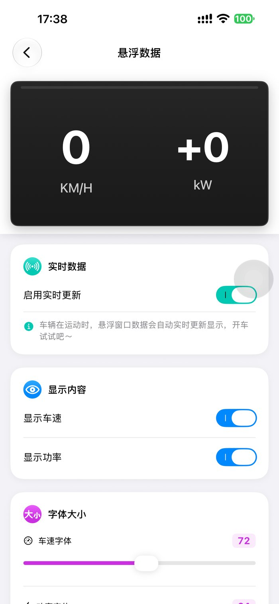

A preview of the floating HUD (speed and power), 启用实时更新, 显示车速, 显示功率, and font-size
sliders for speed and power.

### 3.2 State timeline helpers

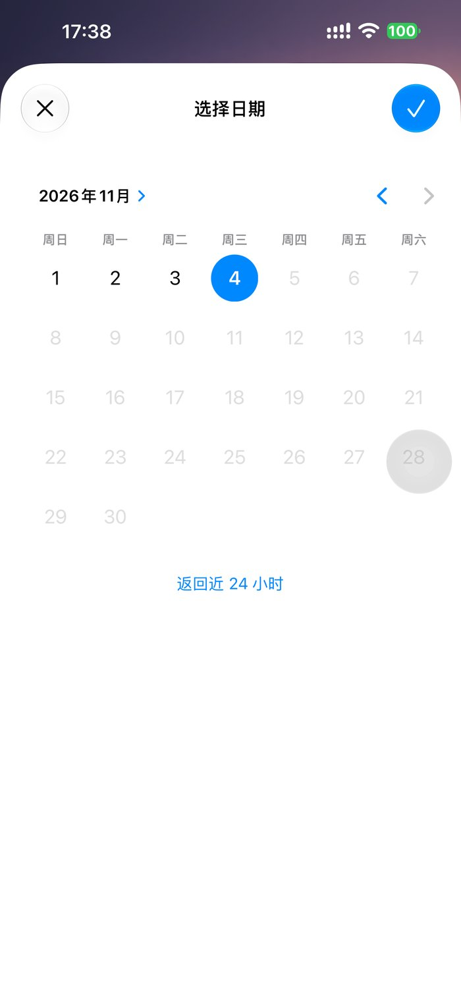

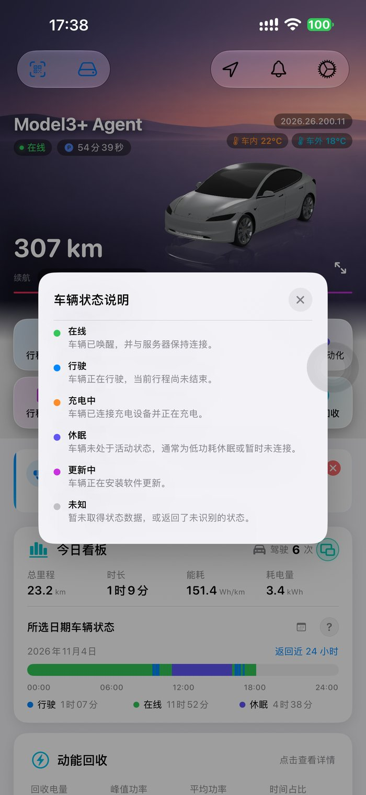

The picker offers the month grid plus 返回近 24 小时. The legend defines 在线, 行驶, 充电中, 休眠,
更新中 and 未知.

### 3.3 3D viewer and desktop widget

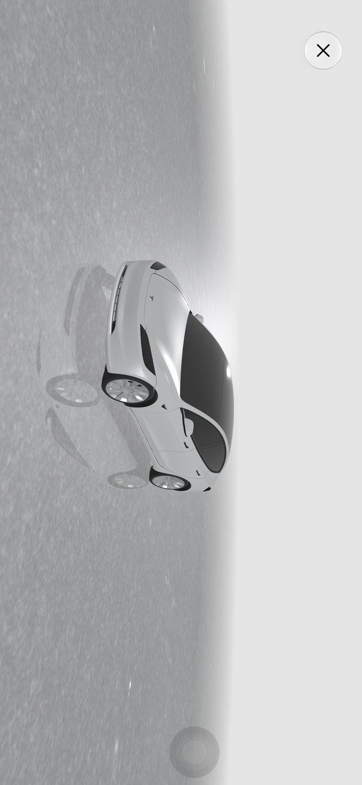

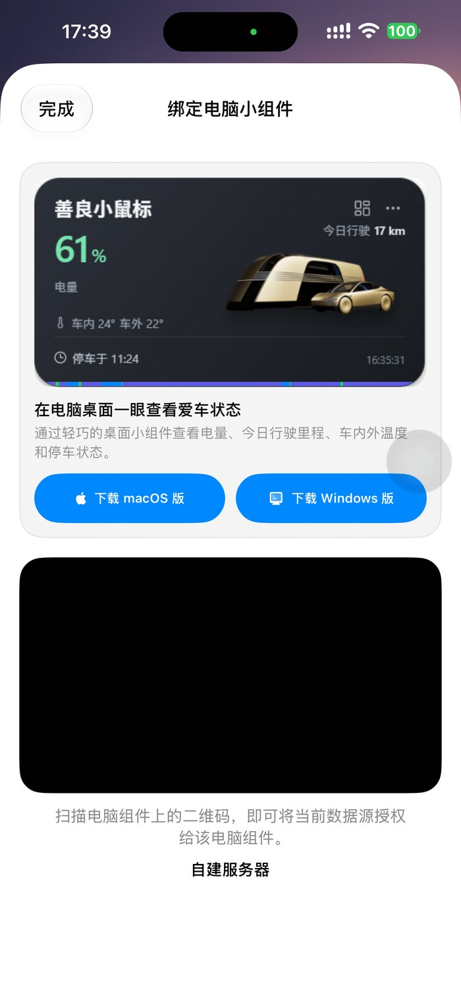

The QR button opens 绑定电脑小组件: a mock of the macOS/Windows desktop widget (battery, today's
distance, temperatures, parked since), download buttons, and a QR area that authorizes the
current data source to the widget.

## 4. 行程记录 — drives

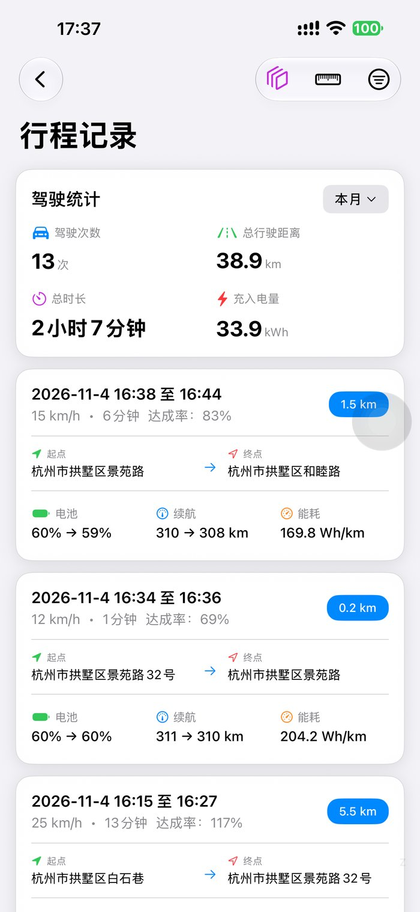

- Statistics card with a period selector (本月): drives, distance, duration, energy added.
- One card per drive: time range, average speed, duration, 达成率 (efficiency against rated
  range), distance badge, origin → destination, battery %, range and Wh/km.
- Toolbar: 合并行程 (merge trips), 距离筛选 (minimum distance), 筛选 (time filter).

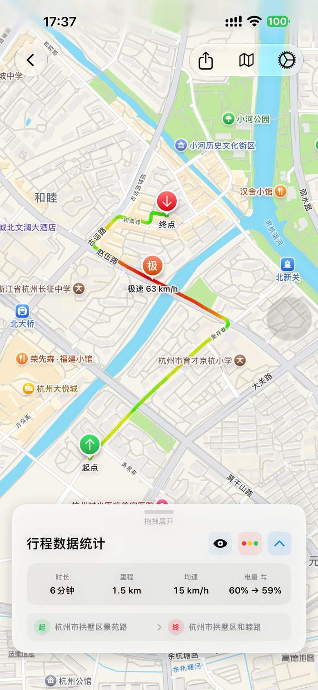

Tapping a card opens a map with the route, start and end pins and the point of 极速 (maximum
speed). A draggable bottom sheet, 行程数据统计, shows duration, distance, average speed and
battery change, plus share, map-style and settings buttons.

## 5. 充电记录 — charging sessions

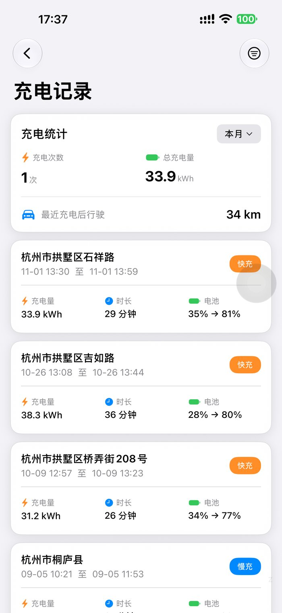

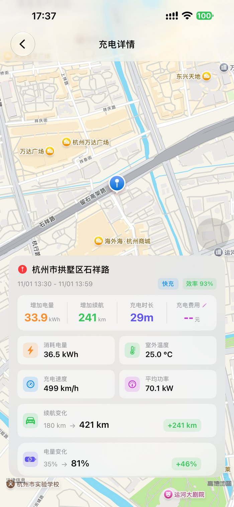

- List: session count, total kWh, distance since the last charge; cards with location, time
  range, AC/DC badge (快充 / 慢充), energy, duration and battery %.
- Detail: map pin plus 充电详情 — added energy and range, duration, cost placeholder, energy
  consumed, outside temperature, charging speed in km/h, average power, range and battery change.
- DC sessions are labelled 快充, AC sessions 慢充.

## 6. 停车记录 — parking and sleep

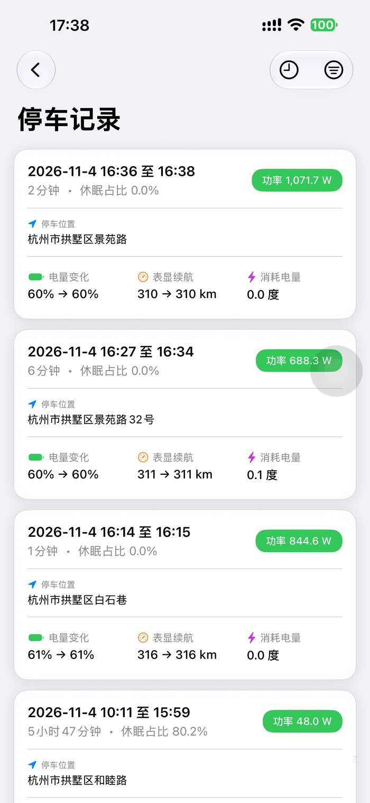

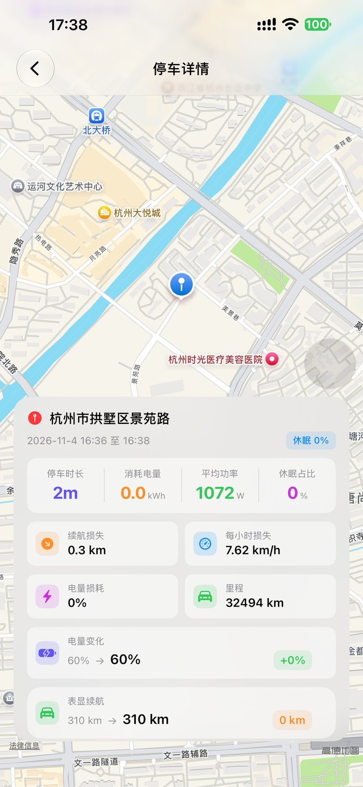

- List: duration, sleep share, average power in W, location, battery %, range and kWh.
- Detail: 停车详情 with parking duration, energy consumed, average power, sleep share, range
  loss, loss per hour, battery loss %, odometer, battery and range change.

## 7. 电池报告 — battery health

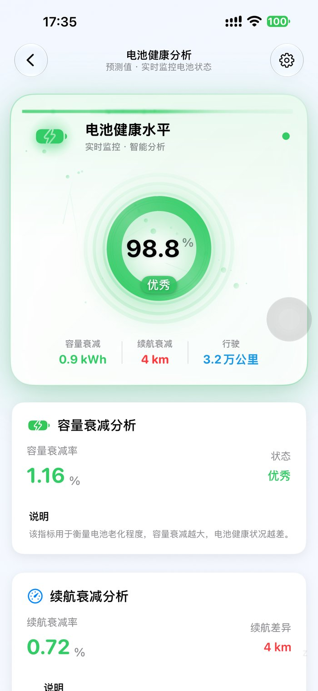

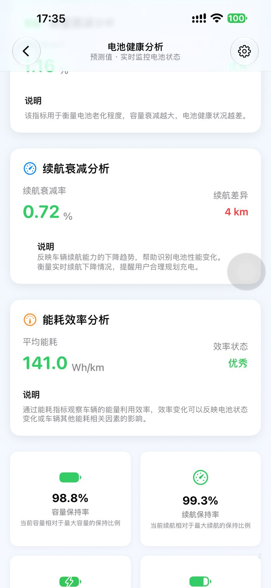

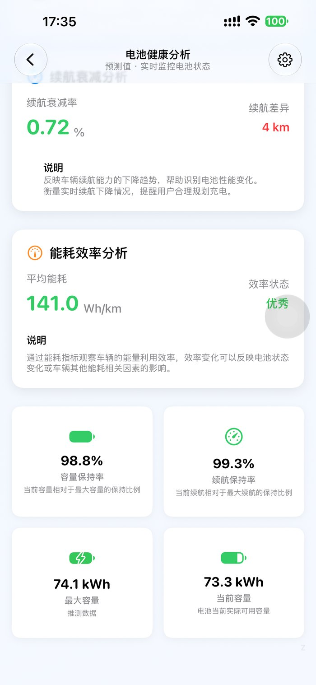

- Health ring with a percentage and rating (优秀), capacity loss, range loss, total distance.
- 容量衰减分析 and 续航衰减分析: rate, status, delta and an explanatory paragraph.
- 能耗效率分析: average Wh/km with a rating and explanation.
- Retention tiles: 容量保持率, 续航保持率, 最大容量 (estimated), 当前容量.

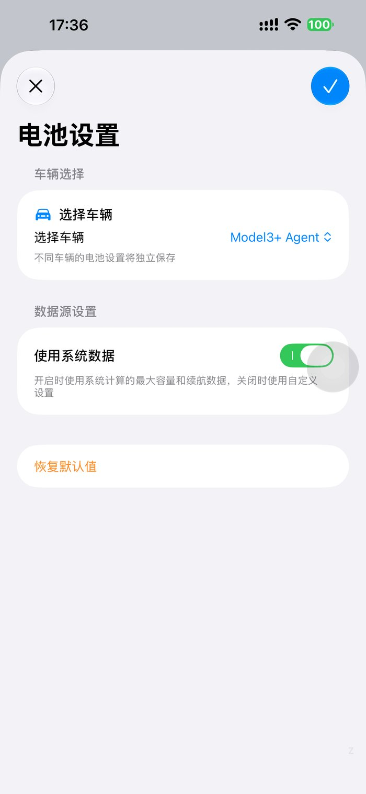

The gear opens 电池设置: per-vehicle selection (each vehicle keeps its own settings), a
使用系统数据 toggle that switches between system-computed capacity/range and custom values, and
恢复默认值.

## 8. 行程日历 — trip calendar

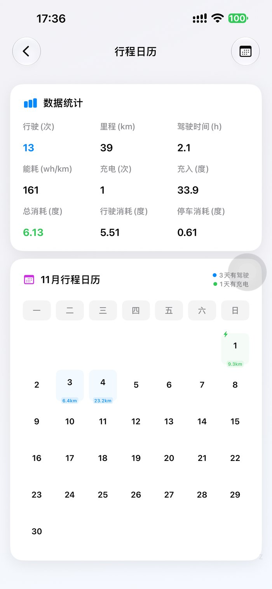

Nine-stat grid for the month (drives, distance, driving hours, Wh/km, charges, kWh added, total /
driving / parked consumption) and a month calendar marking days with drives (blue) and charges
(green), each with that day's distance. The month button in the toolbar changes the month.

## 9. 地图轨迹 — track map

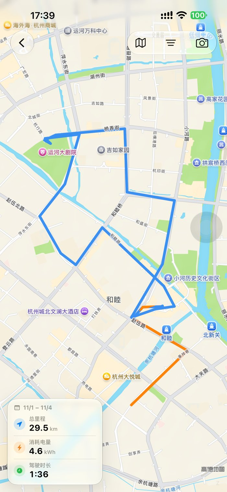

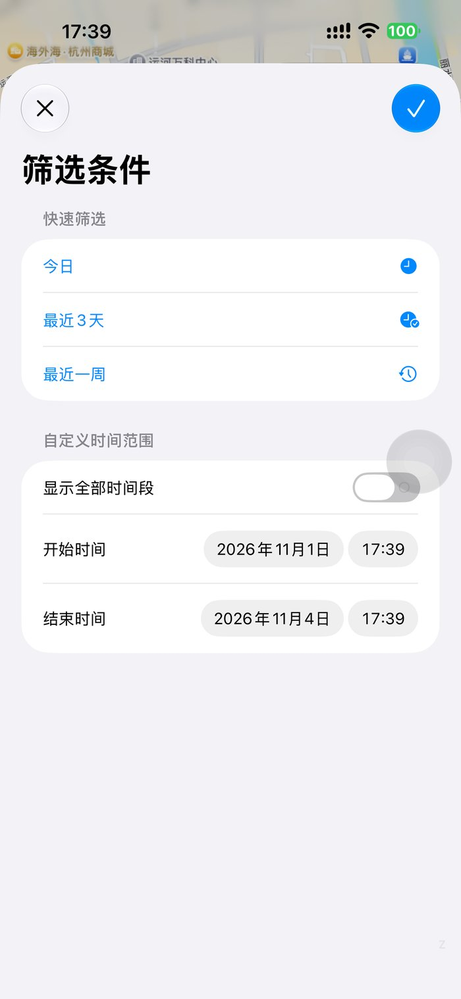

- Full-bleed 高德 map; each trip is a coloured polyline with start and end pins.
- Floating summary for the selected range (distance, energy, driving time).
- Toolbar: 地图样式, 筛选, 保存地图图片.
- Filter sheet: quick filters 今日 / 最近 3 天 / 最近一周, plus a custom range with
  "show all time" and start/end date-time pickers.

## 10. 充电地图 — charging-station map

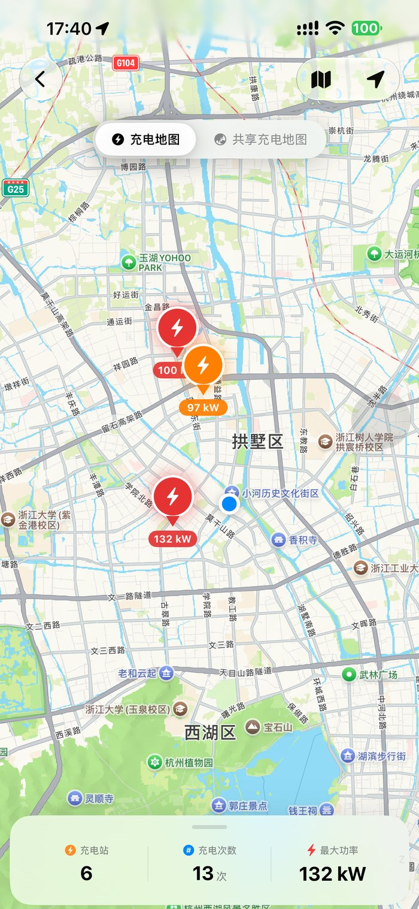

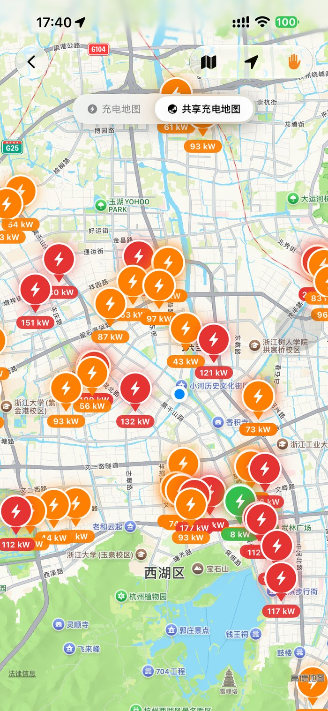

- Switcher 充电地图 / 共享充电地图. The first mode shows stations this vehicle has used (with
  rated power); the shared mode shows the wider station network.
- Pins carry power labels (24–132 kW); the top bar has 地图样式 and 定位到我的位置.
- Bottom summary: 充电站 count, 充电次数, 最大功率.

## 11. 能耗分析 — consumption by software version

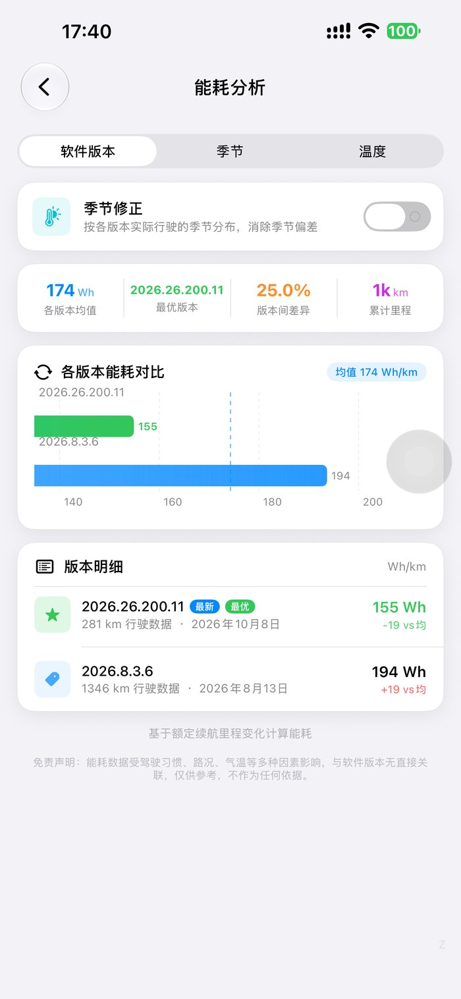

- Tabs 软件版本 / 季节 / 温度; a 季节修正 toggle (normalises each version's seasonal mix).
- Summary strip: average Wh/km, best version, spread between versions, cumulative distance.
- Per-version bar comparison against the mean, marked with a dashed average line.
- Version list with 最新 / 最优 tags, distance covered, date and delta versus the mean.
- Footnote on how consumption is derived and a disclaimer.

## 12. 动能回收 — regenerative braking

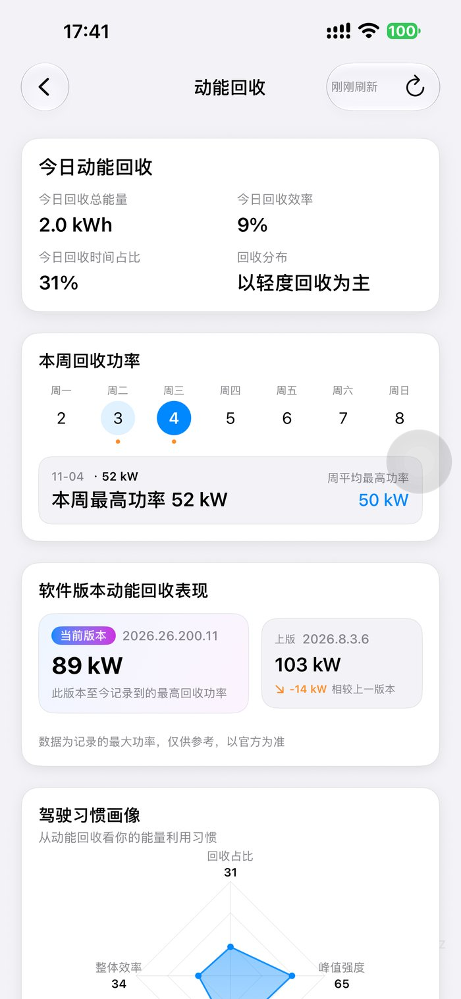

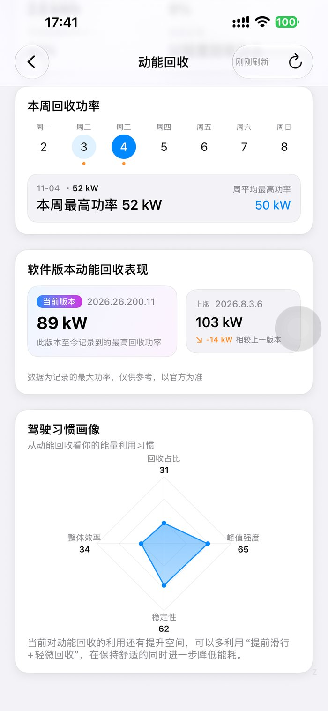

- Today: recovered energy, efficiency, time share, distribution descriptor.
- 本周回收功率: weekday strip with charge markers, the week's maximum and the weekly average max.
- Software-version comparison (current vs previous) of the highest recorded regen power.
- 驾驶习惯画像: radar chart over 回收占比 / 峰值强度 / 稳定性 / 整体效率 with a short coaching line.

## 13. 设置 — appearance, data source, server

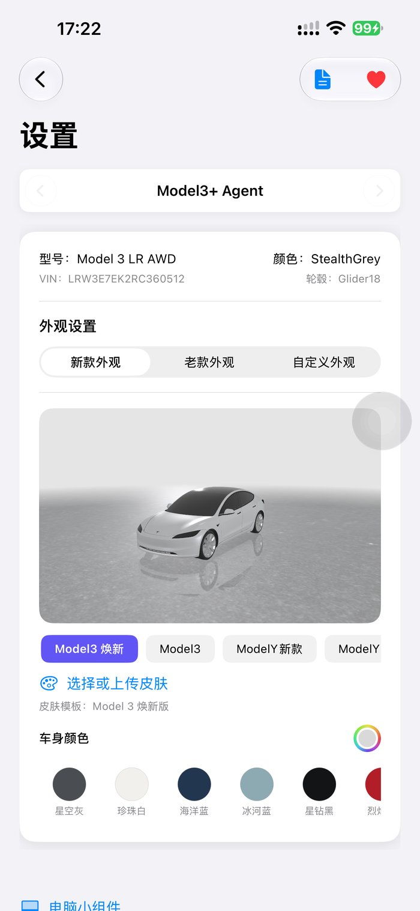

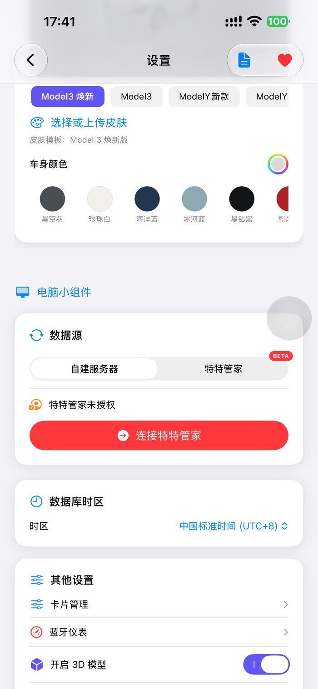

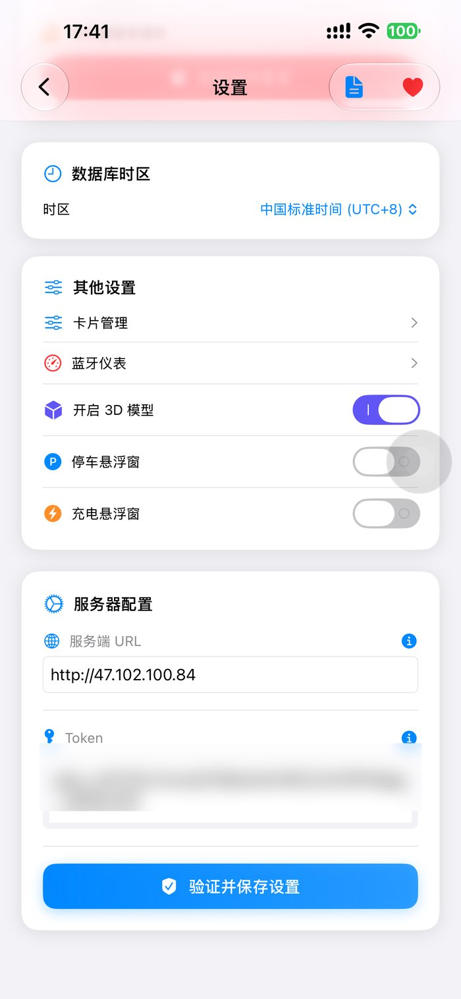

- Vehicle switcher plus model, paint, VIN and wheels.
- 外观设置: 新款 / 老款 / 自定义 exterior, four body presets (Model3 焕新, Model3, ModelY 新款,
  ModelY), 选择或上传皮肤 with a skin template, and paint-colour swatches.
- 电脑小组件: data source 自建服务器 / 特特管家 (BETA), authorization state and
  连接特特管家; database timezone.
- 其他设置: 卡片管理, 蓝牙仪表, 开启 3D 模型, 停车悬浮窗, 充电悬浮窗.
- 服务器配置: server URL, access token, 验证并保存设置 (this is how the app reads a
  self-hosted TeslaMate-style API, which is the same pattern Odo uses).
- Toolbar: 免责声明 (in-app web page) and 赞助 APP.

### 13.1 卡片管理

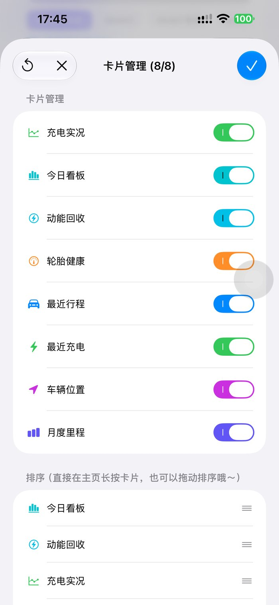

Toggles for the eight home cards (充电实况, 今日看板, 动能回收, 轮胎健康, 最近行程, 最近充电,
车辆位置, 月度里程) and a drag-to-reorder list; cards can also be reordered by long-pressing them
on the home page.

### 13.2 蓝牙仪表

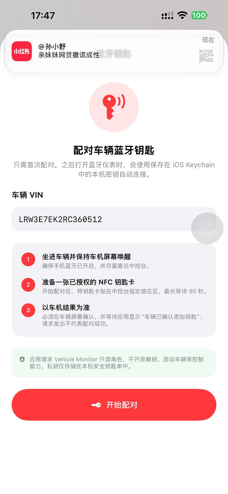

Pairs the phone as a Tesla BLE key: VIN is shown, then three steps (stay in the car, have an
enrolled NFC card ready, confirm on the car screen). The page states that the app requests the
read-only Vehicle Monitor role, cannot unlock or start the car, and keeps the private key in the
iOS Keychain.

### 13.3 免责声明

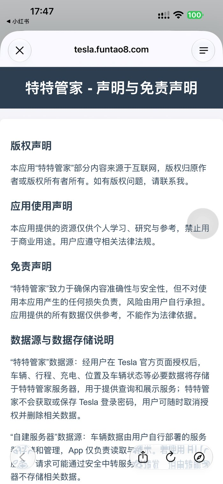

An in-app web page (`tesla.funtao8.com`) covering copyright, usage, liability and data-source
statements for both the Teskeeper cloud and self-hosted-server modes.

## 14. 通知 — notifications

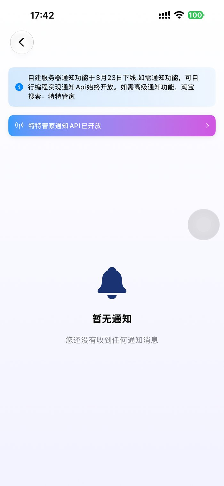

Notice that self-hosted notification delivery was retired on 23 March with a link to the
Teskeeper notification API, an entry point for that API, and an empty state.

## 15. 寻找车辆 — find my car

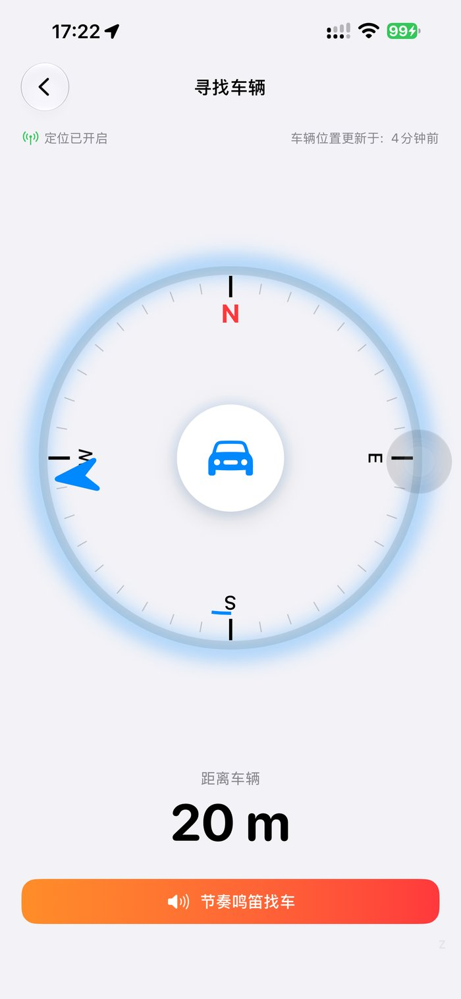

Compass pointing at the car, distance in metres, location permission state, last position
update and a 节奏鸣笛找车 (honk in rhythm) button.

## 16. 行车记录仪查看 — dashcam viewer

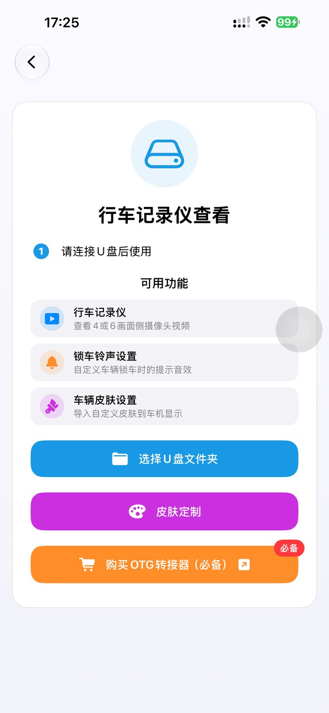

Requires a USB drive. Lists 行车记录仪 (4- or 6-camera side video), 锁车铃声设置 (lock chime) and
车辆皮肤设置 (on-screen skin); actions are 选择 U 盘文件夹, 皮肤定制 and 购买 OTG 转接器 (marked
required).

## 17. 车辆自动化 — automation and Tesla authorization

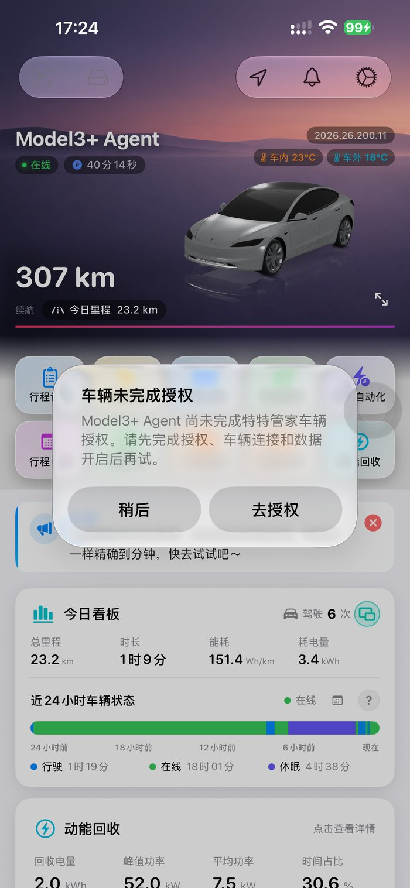

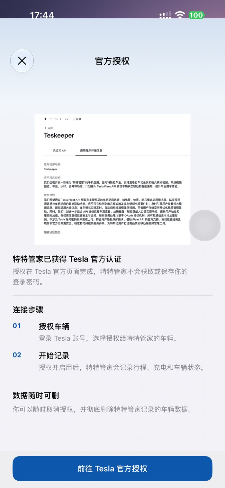

Tapping 车辆自动化 on a data-only account shows 车辆未完成授权 with 稍后 / 去授权. The
authorization screen explains the Tesla developer-app scope (vehicle data, sentry and dashcam
video), the two steps (authorize the vehicle, start recording), that data can be deleted at any
time, and opens Tesla's official OAuth page. Automations themselves (timed climate control and
similar) require this authorization and could not be captured.

## 18. Implementation notes

- SwiftUI app hosting a `NavigationStack` per page; large title plus rounded cards, and a
  consistent right-aligned pill toolbar.
- The car is a SceneKit/USDZ node tree with named meshes (`Body`, `Bumper_F_Base`, `ChargeCap`, …)
  reused on the home hero, the full-screen viewer and the appearance editor, with downloadable
  skins.
- Maps are 高德 (AMap) with per-trip polylines, station pins and a bottom sheet.
- BLE key pairing follows Tesla's vehicle-command protocol with a read-only role; the key lives in
  the Keychain.
- Data concepts map closely onto TeslaMate's: drives, charging processes, parked/sleep states,
  battery health, tracks, consumption, regen — plus presentation extras (HUD, desktop widget,
  skins, notifications).
- Every toolbar button and tile exposes an accessibility label, which made scripted capture
  possible.

## 19. Not captured

- Automation flows beyond the authorization gate.
- Notification API detail page (entry point present, did not open under automation).
- 合并行程 and 距离筛选 result screens for drives.
- Skin upload/editor screens inside 选择或上传皮肤.
- Anything behind the Teskeeper cloud login (account, purchases).
