# 特特管家（Teskeeper）页面与功能参考

第三方特斯拉伴侣 App 的完整页面记录，作为 Oto 的设计与功能参考。
English：[`REFERENCE-TETE.md`](REFERENCE-TETE.md)。截图目录：[`mockups/tete/`](mockups/tete/)。
Oto 的缺口与补充建议：[`GAP-ANALYSIS.zh-CN.md`](GAP-ANALYSIS.zh-CN.md)。

---

## 1. 采集信息

| 项目 | 内容 |
| --- | --- |
| 设备 | iPhone 14 Pro Max（iPhone15,3），iOS 27.2 |
| App | Teskeeper 3.0.2，Bundle ID `com.axbear.love.TeslaCamera`（App Store：特特管家-特斯拉车主必备） |
| 采集日期 | 2026-11-04 |
| 车辆 | Model 3 LR AWD（"Model3+ Agent"），软件版本 2026.26.200.11，VIN LRW3E7EK2RC360512 |
| 方式 | `xcrun devicectl device capture screenshot` 截图 + 临时 XCUITest target 驱动导航（结束后已移除） |
| 脱敏 | 设置页截图中的 Token 已模糊处理；服务端 URL 为本人自建服务 |

截图为 1290×2796 原图的 700 px 宽 JPEG。所有页面均由真实点按进入，与应用实际呈现一致。

## 2. 页面地图

首页是一条长滚动页加十个功能入口，其余页面都从首页磁贴或顶栏进入；没有底部 Tab Bar。

| # | 页面 | 入口 |
| --- | --- | --- |
| 1 | 首页（车辆总览） | 启动 App |
| 2 | 悬浮数据（行车 HUD 设置） | 首页 今日看板 → `pip` 按钮 |
| 3 | 选择日期（状态时间轴日期选择） | 首页 今日看板 → 日历按钮 |
| 4 | 车辆状态说明（状态图例） | 首页 今日看板 → `?` 按钮 |
| 5 | 3D 车模全屏 | 首页车辆卡 → 全屏按钮 |
| 6 | 绑定电脑小组件 | 顶栏 → 二维码按钮 |
| 7 | 行程记录 + 行程详情 | 首页磁贴 |
| 8 | 充电记录 + 充电详情 | 首页磁贴 |
| 9 | 停车记录 + 停车详情 | 首页磁贴 |
| 10 | 电池健康分析 + 电池设置 | 首页磁贴 |
| 11 | 行程日历 | 首页磁贴 |
| 12 | 地图轨迹 + 筛选条件 | 首页磁贴 |
| 13 | 充电地图 / 共享充电地图 | 首页磁贴 |
| 14 | 能耗分析 | 首页磁贴 |
| 15 | 动能回收 | 首页磁贴 |
| 16 | 车辆自动化 → 官方授权 | 首页磁贴 |
| 17 | 设置（外观、数据源、服务器） | 顶栏齿轮 |
| 18 | 卡片管理 / 蓝牙仪表 / 免责声明 | 设置页 |
| 19 | 通知 | 顶栏铃铛 |
| 20 | 寻找车辆 | 顶栏箭头 |
| 21 | 行车记录仪查看 | 顶栏行车记录仪图标 |

## 3. 首页 — 车辆总览

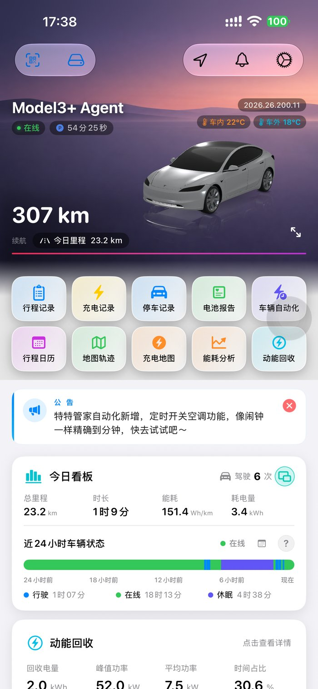

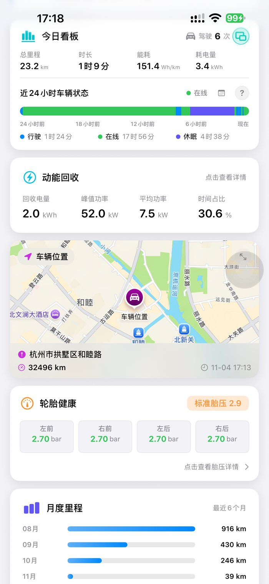

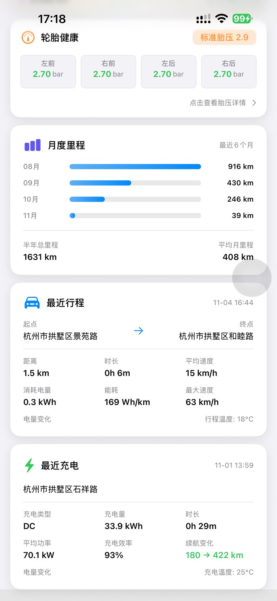

- **顶栏**（胶囊图标）：绑定电脑小组件（二维码）、行车记录仪查看、寻找车辆、通知、设置。
- **车辆卡**：3D 车模、车名、在线状态、驻车时长、软件版本、车内外温度、大字号续航、今日里程、
  电量条，以及全屏查看按钮。
- **十个磁贴**：行程记录、充电记录、停车记录、电池报告、车辆自动化、行程日历、地图轨迹、
  充电地图、能耗分析、动能回收。
- **公告**：可关闭的产品公告（2026-11 为自动化新增定时开关空调）。
- **今日看板**：当日驾驶次数、总里程、时长、能耗、耗电量；近 24 小时车辆状态时间轴
  （行驶 / 在线 / 休眠），配日期选择、图例按钮和 PIP 按钮。选定日期后卡片会切换为
  「所选日期车辆状态」并展示该日时间轴。
- **动能回收**：回收电量、峰值/平均功率、时间占比，可进入详情。
- **车辆位置**：地图卡片，含车辆标记、地址、总里程与更新时间。
- **轮胎健康**：四轮胎压对照标准胎压，可进入详情。
- **月度里程**：最近 6 个月的横向条，附半年总里程与平均月里程。
- **最近行程 / 最近充电**：与列表页卡片同字段的精简版。
- 首页卡片支持长按拖动排序；显示哪些卡片、顺序如何，在「设置 → 卡片管理」里配置。

### 3.1 悬浮数据（HUD 设置）

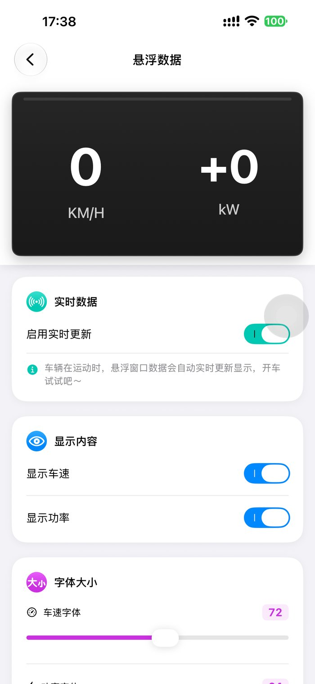

HUD 预览（车速 + 功率）、启用实时更新、显示车速、显示功率，以及车速/功率字号滑杆。

### 3.2 状态时间轴的辅助页

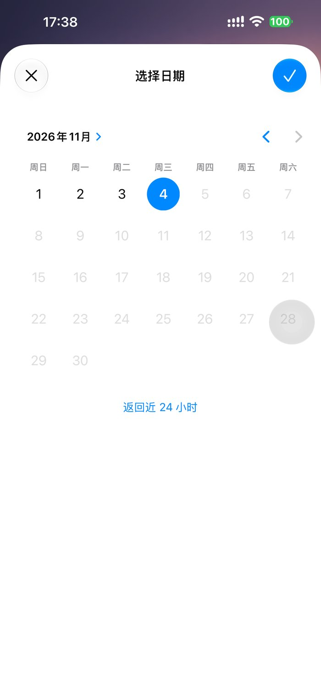

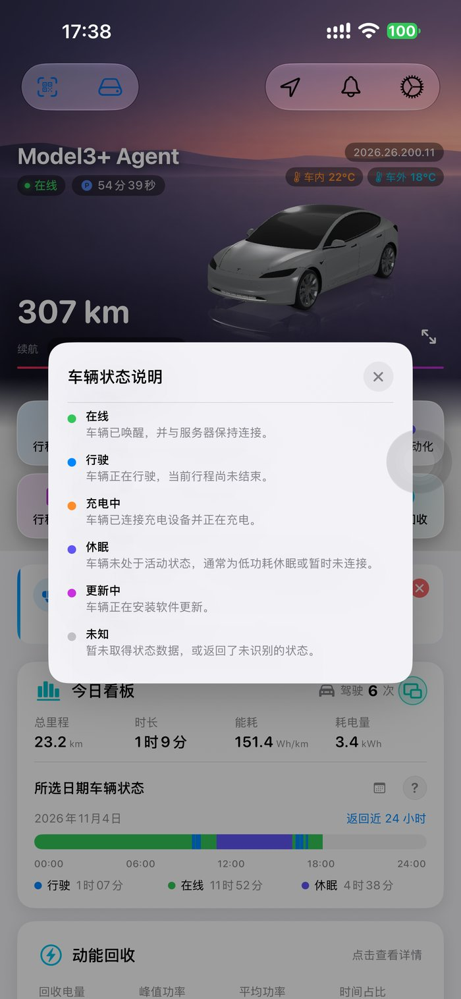

日期选择提供整月日历和「返回近 24 小时」；图例解释 在线、行驶、充电中、休眠、更新中、未知。

### 3.3 3D 全屏与电脑小组件

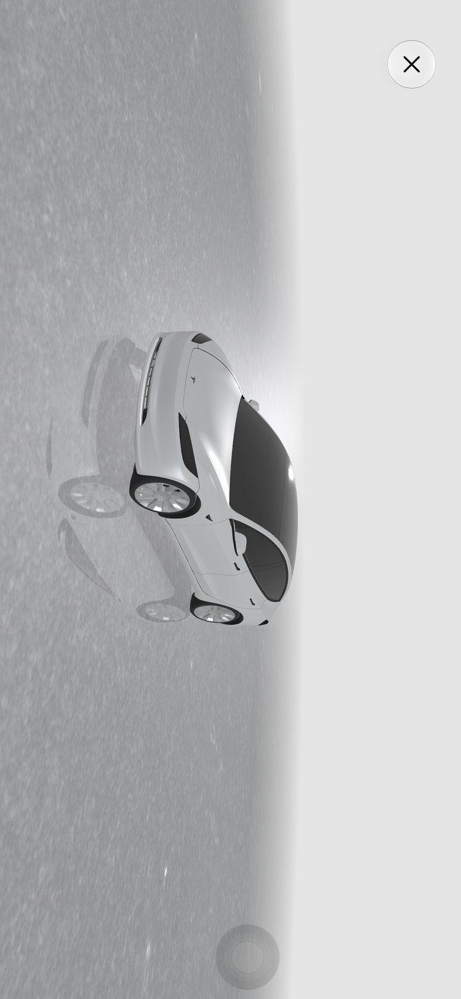

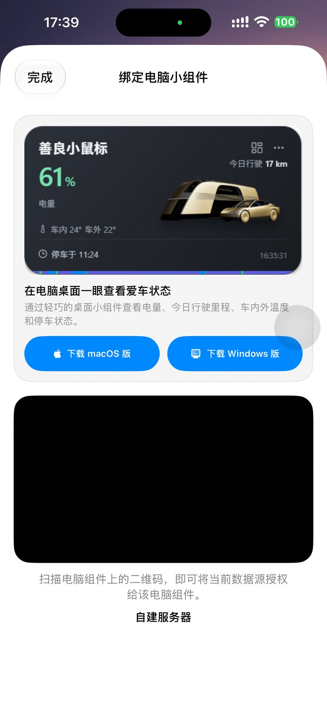

二维码按钮进入「绑定电脑小组件」：macOS/Windows 桌面小组件预览（电量、今日行驶、车内外温度、
停车时间）、下载入口，以及把当前数据源授权给小组件的扫码区域。

## 4. 行程记录 — 驾驶行程

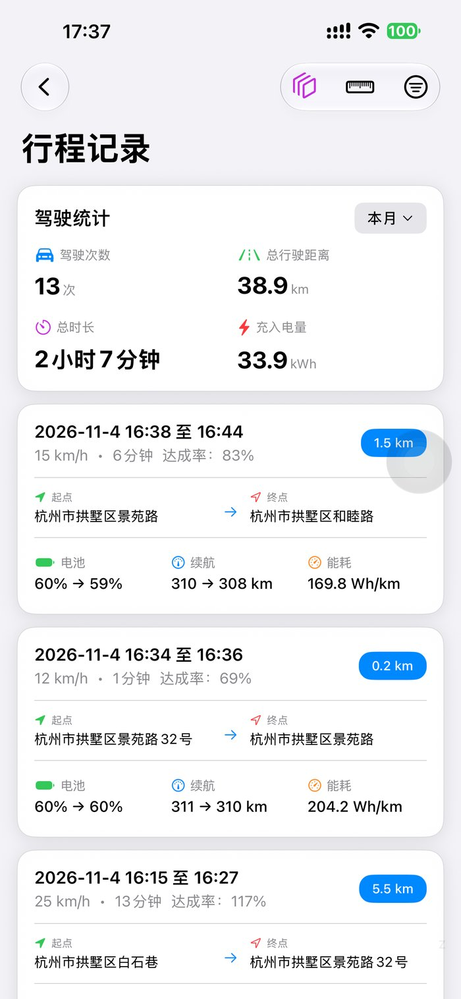

- 统计卡带周期选择（本月）：驾驶次数、总距离、总时长、充入电量。
- 每段行程一张卡：时间范围、平均速度、时长、达成率（相对标称续航的效率）、距离徽标、
  起点 → 终点、电量、续航、能耗（Wh/km）。
- 工具栏：合并行程、距离筛选、筛选（时间）。

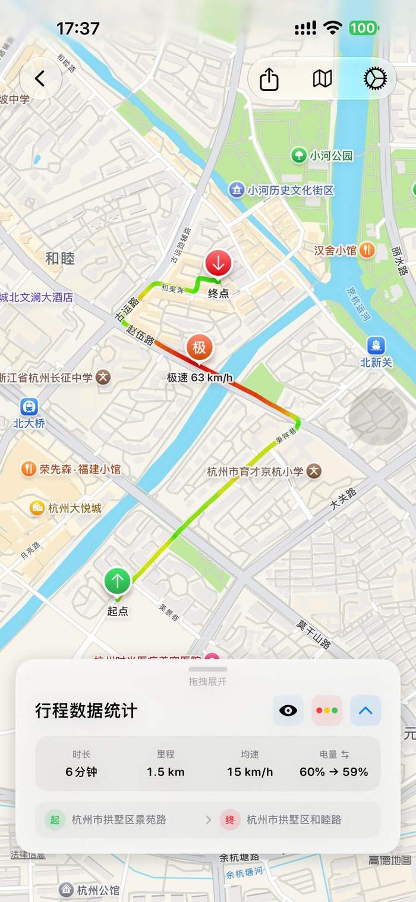

点击卡片进入地图：轨迹线、起点/终点标记与「极速」标记；底部可拖拽的「行程数据统计」显示时长、
里程、均速与电量变化，右上角有分享、地图样式与设置按钮。

## 5. 充电记录 — 充电会话

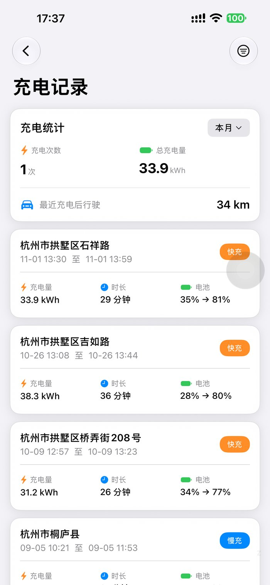

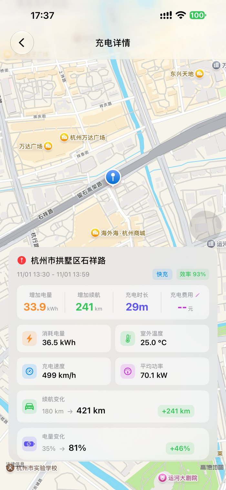

- 列表：充电次数、总充电量、最近充电后行驶；卡片含地点、起止时间、快充/慢充标签、电量、
  时长与电量百分比。
- 详情：地图标记 + 「充电详情」——增加电量与续航、时长、充电费用（占位）、消耗电量、室外温度、
  充电速度（km/h）、平均功率、续航与电量变化。

## 6. 停车记录 — 停车与休眠

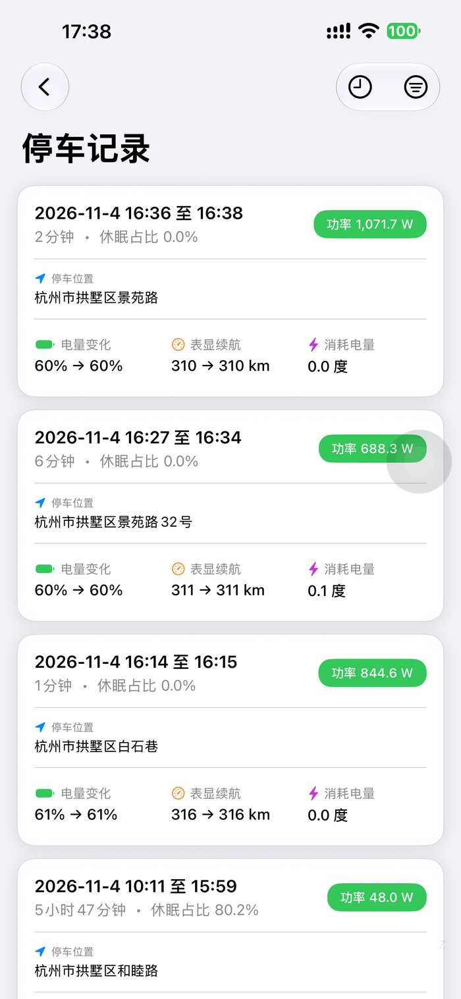

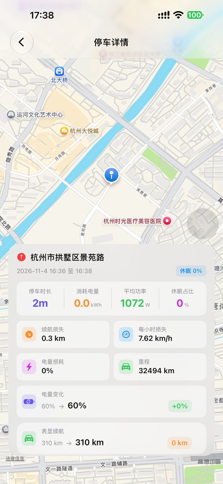

- 列表：停车时长、休眠占比、平均功率（W）、停车位置、电量、表显续航、消耗电量。
- 详情：「停车详情」——停车时长、消耗电量、平均功率、休眠占比、续航损失、每小时损失、
  电量损耗百分比、里程、电量与续航变化。

## 7. 电池报告 — 电池健康

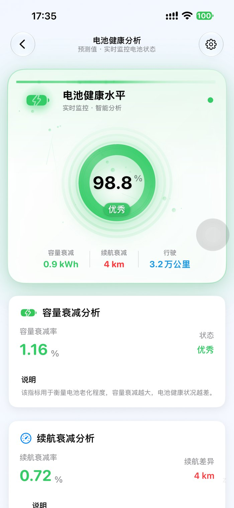

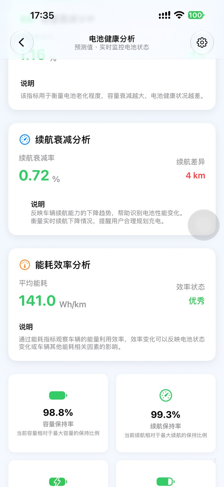

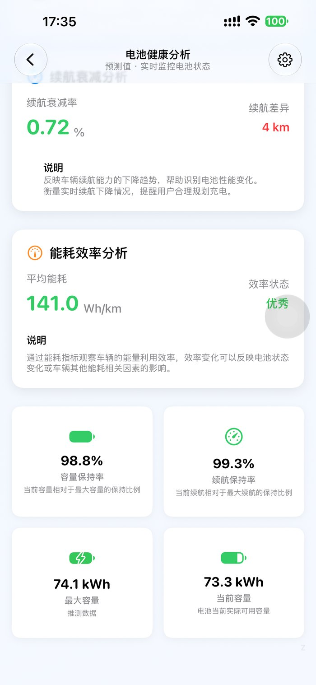

- 健康度环形图与评级（优秀）、容量衰减、续航衰减、累计行驶里程。
- 容量衰减分析、续航衰减分析：衰减率、状态、差值及说明文字。
- 能耗效率分析：平均 Wh/km、效率评级及说明。
- 保持率卡片：容量保持率、续航保持率、最大容量（推测）、当前容量。

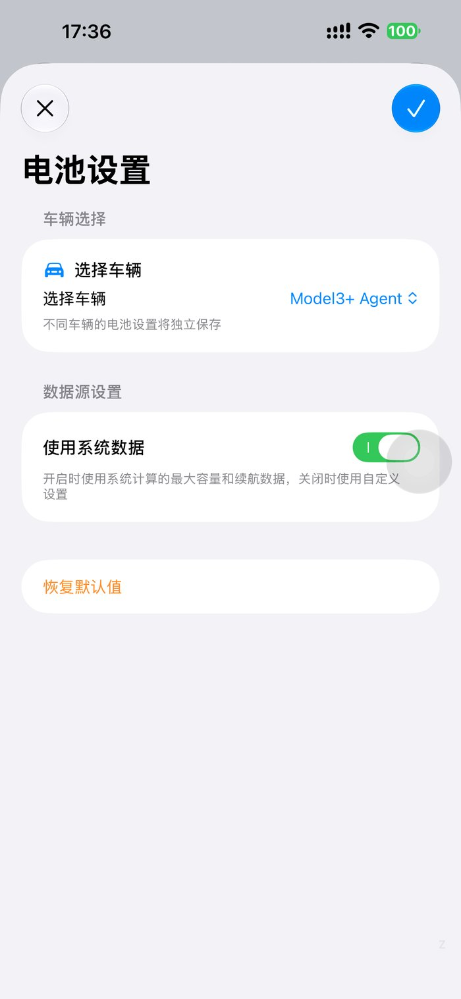

齿轮进入「电池设置」：按车辆独立保存设置、使用系统数据开关（系统计算容量/续航 vs 自定义值）、
恢复默认值。

## 8. 行程日历

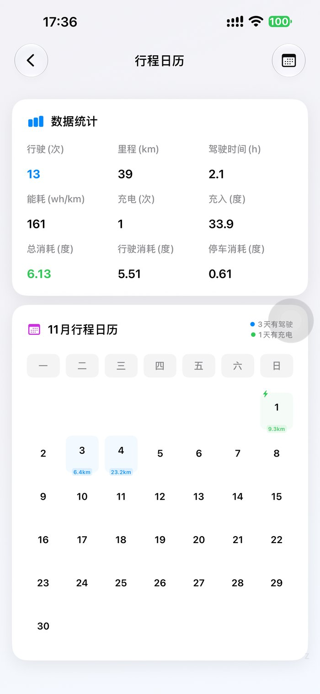

当月九项统计（行驶次数、里程、驾驶时间、Wh/km、充电次数、充入度数、总消耗/行驶消耗/停车消耗），
以及月历——有驾驶的日子标蓝、有充电标绿，并显示当日里程；工具栏月份按钮可切换月份。

## 9. 地图轨迹

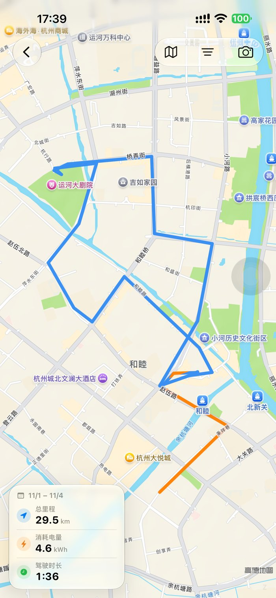

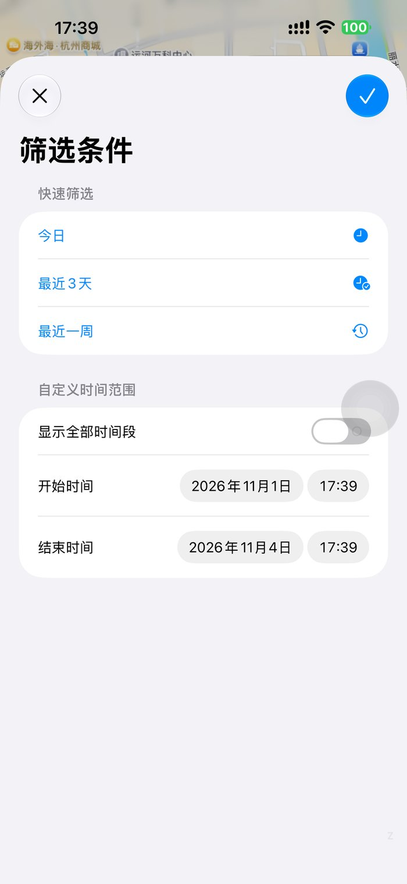

- 全屏高德地图，每次行程一条彩色轨迹，含起点/终点标记。
- 所选时间范围的浮动汇总卡（总里程、消耗电量、驾驶时长）。
- 工具栏：地图样式、筛选、保存地图图片。
- 筛选面板：快速筛选（今日 / 最近 3 天 / 最近一周）+ 自定义时间范围（显示全部时间段开关、
  开始/结束日期时间）。

## 10. 充电地图

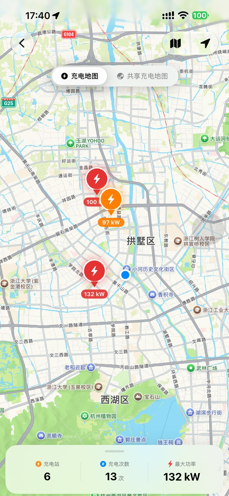

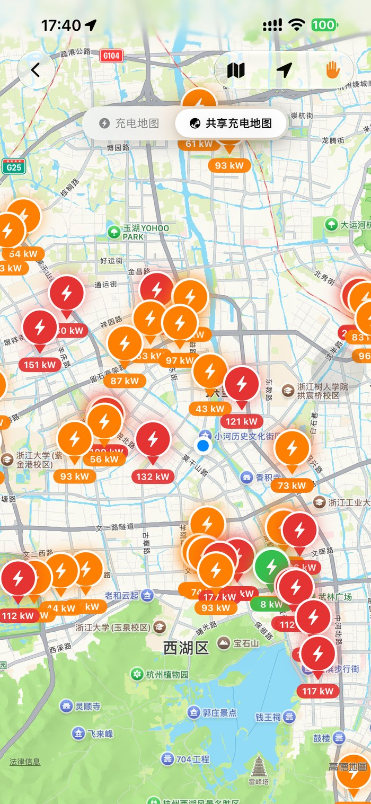

- 「充电地图 / 共享充电地图」切换：前者为本车去过的站点（带功率标注），后者为更广的站点网络。
- 站点 Pin 标注功率（24–132 kW）；顶栏有地图样式与定位到我的位置。
- 底部汇总：充电站数量、充电次数、最大功率。

## 11. 能耗分析

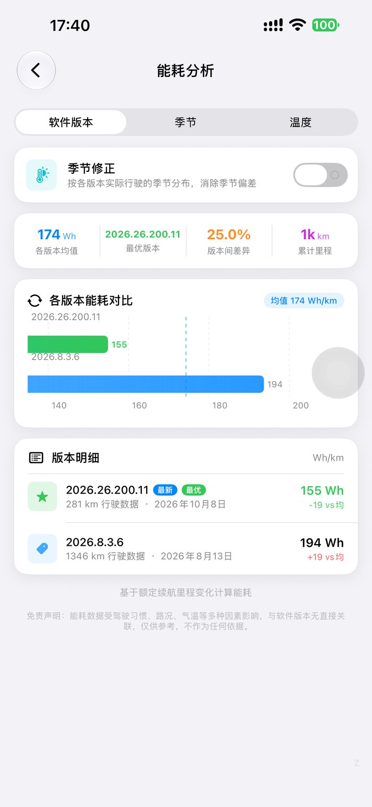

- 三个 Tab：软件版本 / 季节 / 温度；季节修正开关（按各版本实际季节分布消除偏差）。
- 概览条：各版本均值、最优版本、版本间差异、累计里程。
- 各版本能耗对比条形图（含均值虚线）；版本明细列表带「最新 / 最优」标签、行驶里程、日期与
  相对均值的差值。
- 末尾是能耗计算口径与免责声明。

## 12. 动能回收

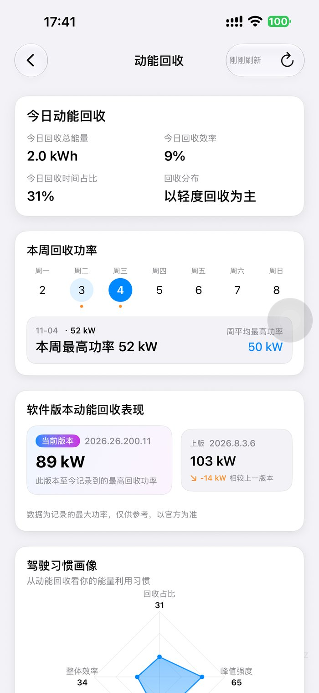

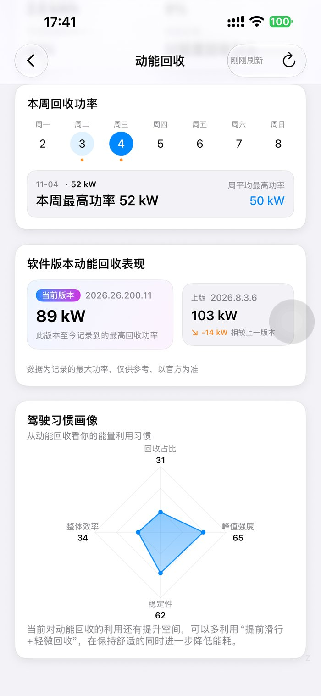

- 今日：回收总能量、回收效率、时间占比、回收分布描述。
- 本周回收功率：周视图（含充电标记点）、本周最高功率与周平均最高功率。
- 软件版本回收表现：当前版本与上一版本的最高回收功率对比。
- 驾驶习惯画像：回收占比 / 峰值强度 / 稳定性 / 整体效率的雷达图，并给出一句驾驶建议。

## 13. 设置 — 外观、数据源、服务器

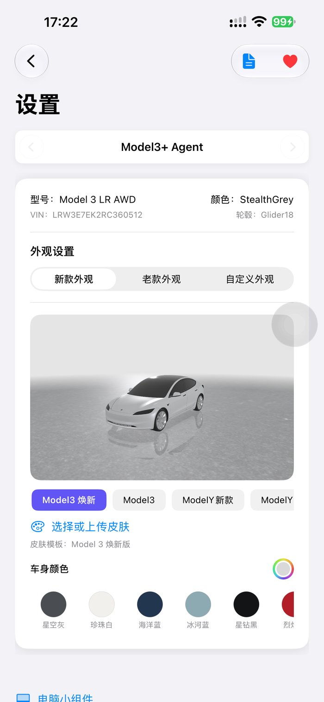

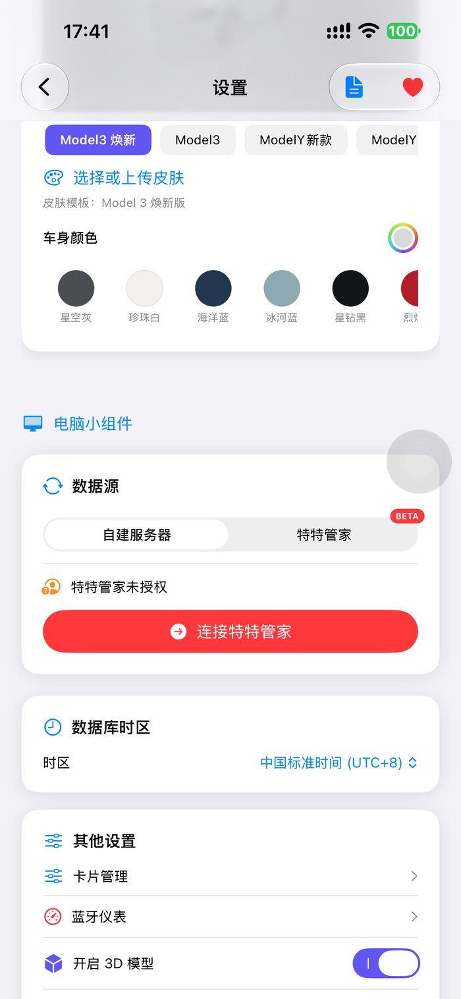

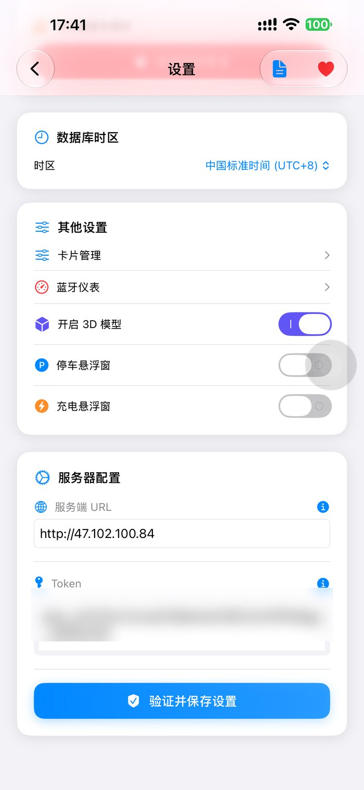

- 车辆切换，以及型号、颜色、VIN、轮毂。
- 外观设置：新款 / 老款 / 自定义外观；四种车身预设（Model3 焕新、Model3、ModelY 新款、ModelY）、
  选择或上传皮肤（含皮肤模板）、车身颜色色板。
- 电脑小组件：数据源「自建服务器 / 特特管家（BETA）」、授权状态与「连接特特管家」、
  数据库时区。
- 其他设置：卡片管理、蓝牙仪表、开启 3D 模型、停车悬浮窗、充电悬浮窗。
- 服务器配置：服务端 URL、Token、验证并保存设置——即通过自建 API 读取数据，与 Oto 的接入方式一致。
- 顶栏：免责声明（内置网页）、赞助 APP。

### 13.1 卡片管理

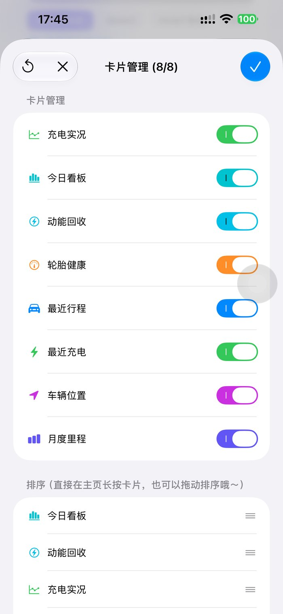

八个首页卡片（充电实况、今日看板、动能回收、轮胎健康、最近行程、最近充电、车辆位置、月度里程）
的开关，以及拖动排序列表；首页长按卡片也可排序。

### 13.2 蓝牙仪表

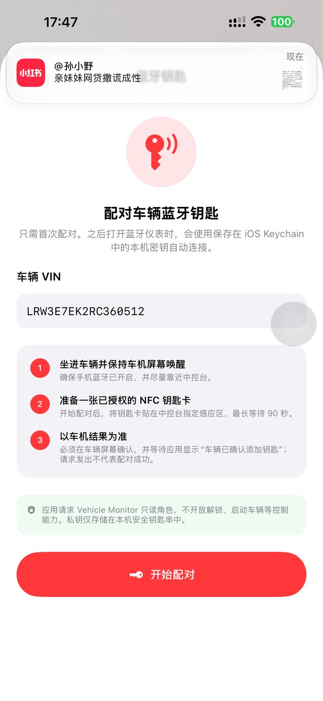

把手机配成特斯拉 BLE 钥匙：显示 VIN，三步说明（坐进车内、准备已授权的 NFC 卡、以车机结果为准）。
页面说明 App 只申请 Vehicle Monitor 只读角色，不能解锁或启动车辆，私钥保存在 iOS Keychain。

### 13.3 免责声明

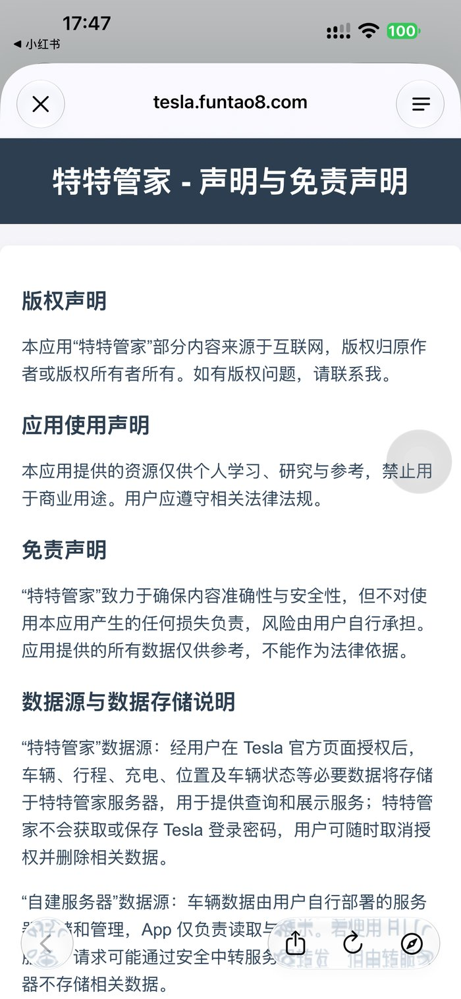

内置网页（`tesla.funtao8.com`），涵盖版权、使用、免责，以及云服务与自建服务器两种模式的数据说明。

## 14. 通知

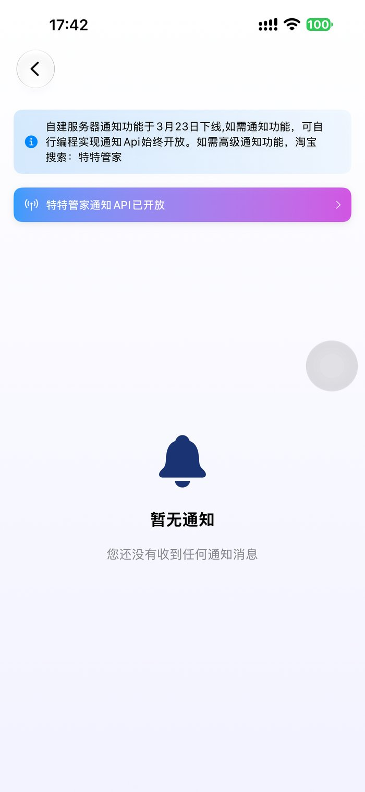

自建服务器通知功能下线说明、特特管家通知 API 入口，以及空状态。

## 15. 寻找车辆

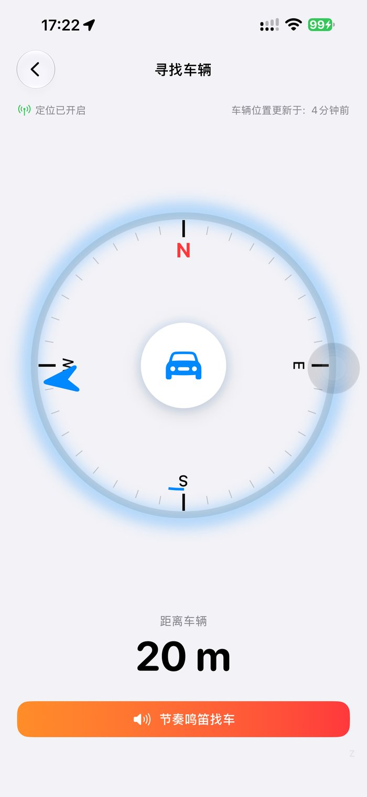

罗盘指向车辆、距离（米）、定位状态、位置更新时间，以及「节奏鸣笛找车」按钮。

## 16. 行车记录仪查看

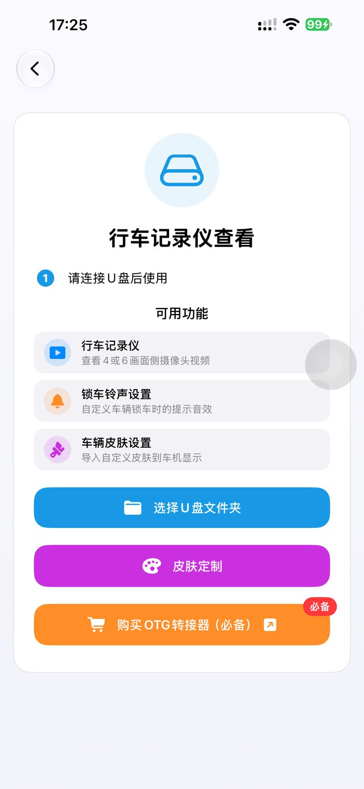

需插入 U 盘。可用功能：行车记录仪（4 或 6 画面侧摄像头视频）、锁车铃声设置、车辆皮肤设置；
操作为选择 U 盘文件夹、皮肤定制、购买 OTG 转接器（标注必备）。

## 17. 车辆自动化 — 自动化与特斯拉授权

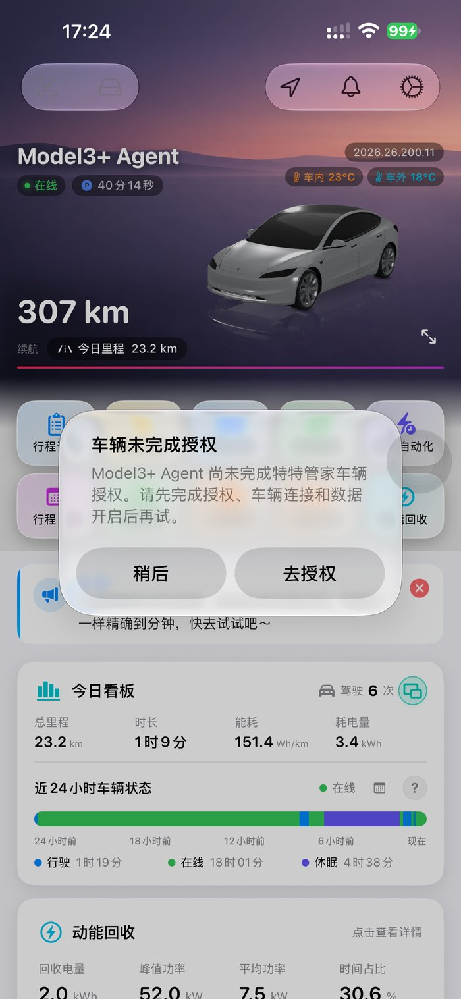

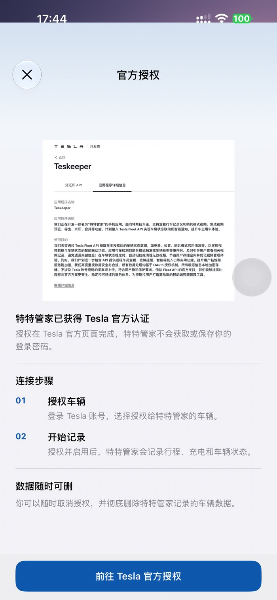

在仅有数据读取权限的账号上点开「车辆自动化」，先弹出「车辆未完成授权」（稍后 / 去授权）。
授权页说明特特管家申请的 Tesla 开发者应用范围（车辆数据、哨兵与行车记录视频）、两步流程
（授权车辆、开始记录）、可随时删除数据，并提供跳转 Tesla 官方 OAuth 的按钮。自动化功能本身
（定时开关空调等）需要完成授权，未能截取。

## 18. 实现要点

- SwiftUI 应用，每页一个 `NavigationStack` 宿主；大标题 + 圆角卡片的统一版式，
  右侧胶囊工具栏保持一致。
- 车模为 SceneKit/USDZ 节点树（`Body`、`Bumper_F_Base`、`ChargeCap` 等命名网格），
  首页英雄区、全屏查看与外观编辑器共用，并支持下载皮肤。
- 地图为高德（AMap）：行程折线、站点 Pin、底部抽屉。
- 蓝牙钥匙遵循特斯拉 vehicle-command 协议，只申请只读角色，私钥存 Keychain。
- 数据概念与 TeslaMate 高度对应：行程、充电、停车/休眠、电池健康、轨迹、能耗、动能回收；
  额外有 HUD、桌面小组件、皮肤、通知等展示型功能。
- 顶栏按钮和磁贴都暴露了无障碍标签，这也是脚本化采集可行的原因。

## 19. 未采集

- 授权之外的自动化配置页。
- 通知 API 详情页（入口存在，自动化下未成功打开）。
- 行程记录里的「合并行程」「距离筛选」结果页。
- 「选择或上传皮肤」中的上传/编辑页。
- 特特管家云账号相关（登录、购买）。
